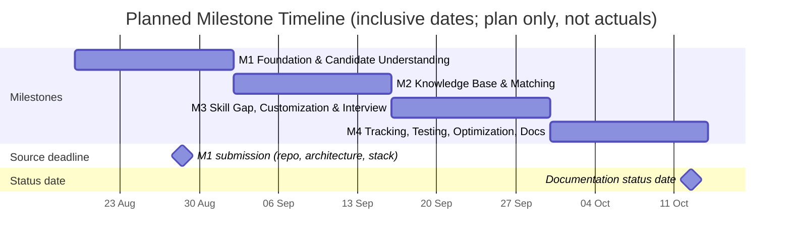
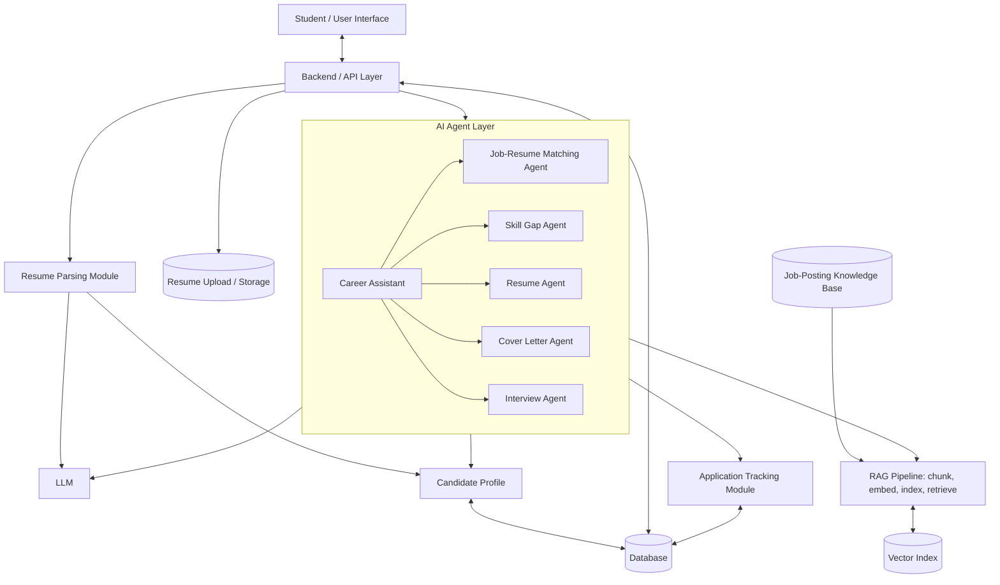
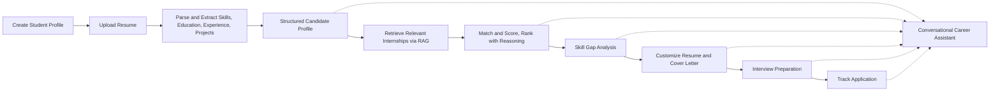
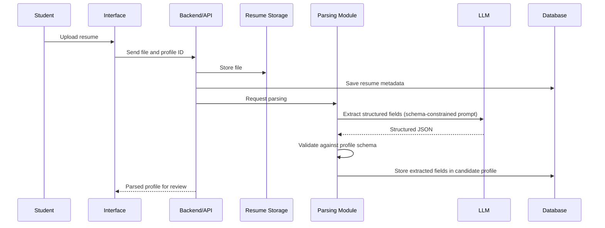

# AI Career Companion Agent for Internship Matching and Interview Preparation
## Agile Project Documentation Package

---

## 0. Document Control

| Field | Value |
|---|---|
| Project name | AI Career Companion Agent for Internship Matching and Interview Preparation |
| Document title | Agile Project Documentation Package |
| Version | 0.1 (Draft, living document) |
| Status date | 12 October 2026 (Monday) |
| Project start date | 19 August 2026 (Wednesday) |
| Methodology | Agile; milestone-based planning with two-week iterations |
| Project status | **ONGOING.** Milestone 4 is in its planned window as of the status date. The project is not complete. |
| Document owner | TBD |
| Contributors / team members | Not recorded |
| Authoritative requirements source | `Project Details.txt` (Milestones 1–4) |
| Repository evidence reviewed | **None.** Only `Project Details.txt` was supplied. All technical implementation sections require repository verification. |
| Intended file name | `AGILE_PROJECT_DOCUMENTATION.md` |

### 0.1 Status Vocabulary

| Label | Meaning |
|---|---|
| **Planned** | Scheduled, with no evidence of work started |
| **In progress** | Evidence of work started but not accepted |
| **Completed (verified)** | Meets acceptance criteria, with linked evidence |
| **Blocked** | Cannot proceed; blocker logged |
| **Unverified** | Might be done or not; no evidence supplied |
| **Overdue — status unverified** | Planned end date has passed and no completion evidence exists |
| **Not measured / Not recorded / TBD** | Information absent; never to be guessed |

### 0.2 Date Convention

All milestone date ranges use **calendar days, with both the start date and the end date inclusive**. Each milestone spans exactly 14 calendar days (Wednesday to the Tuesday of the following week). The next milestone starts the day after the previous one ends. Planned dates are never shifted to match the current date.

---

## 1. Analysis of Supplied Project Details

### 1.1 Summary of Source

`Project Details.txt` defines one project with four milestones. Each has four numbered objectives and a four-part breakdown (M1.1–M4.4), giving **16 subtasks** in total.

| Milestone | Theme | Subtasks |
|---|---|---|
| M1 | Foundation & Candidate Understanding | M1.1 Research; M1.2 Architecture; M1.3 Student Profile Module; M1.4 Resume Parsing & Extraction |
| M2 | Internship Knowledge & Job-Resume Matching | M2.1 Dataset & KB; M2.2 RAG Pipeline; M2.3 Matching Agent; M2.4 Evaluation |
| M3 | Skill Gap, Application Customization & Interview Prep | M3.1 Skill Gap Agent; M3.2 Resume & Cover Letter Agent; M3.3 Interview Agent; M3.4 Conversational Assistant |
| M4 | Tracking, Testing, Optimization & Documentation | M4.1 Application Tracking; M4.2 End-to-End Testing; M4.3 Optimization; M4.4 Documentation & Demo |

### 1.2 Observations, Ambiguities and Discrepancies in the Source

| # | Observation | Handling in this document |
|---|---|---|
| S-1 | The source gives a submission date of **28 August (Friday)** for the Milestone 1 deliverables (GitHub link, architecture, tech stack). 28 Aug 2026 is a Friday, consistent with the source. It falls on day 10 of the 14-day M1 window (19 Aug–1 Sep). | Preserved as a **source-specified submission deadline**, inside the M1 window. Whether it was met is **not recorded**. |
| S-2 | M1.2 lists **Resume Agent** and **Cover Letter Agent** as separate agents. M3.2 describes a single **Resume and Cover Letter Customization Agent**. | Flagged. Decision **D-001** is proposed. Until confirmed, both are treated as one logical agent with two capabilities (or two sub-agents). |
| S-3 | M1.2 names six agents, and the M3.4 integration list names five outputs. Stage names differ slightly between prose ("Planning to apply", "Application under review") and the master prompt ("Planning to Apply", "Under Review"). | The master prompt's stage names are used. Stages are configurable per M4.1. |
| S-4 | Several items are labelled "can be modified". These are job-posting fields, matching comparison lists, application stages, reminder types and dashboard items. | Treated as configurable. Deviations are recorded in the Decision Log. |
| S-5 | Mock interviews (M3.3) are marked "Optionally". Reminders (M4.1) are "can be modified". | Documented as **optional / conditional**. They count as delivered only if implemented and verified. |
| S-6 | The source provides no team names, repository URL, tech stack choices, test results or progress records. | All marked **TBD / Not recorded**. |
| S-7 | Source says "150–200 sample job postings". The dataset's actual size is unknown. | Dataset is treated as **not confirmed collected**. |
| S-8 | Planned end of M1–M3 (1, 15, 29 Sep) has passed at the status date. | Marked **Overdue — status unverified** (Section 4 and Section 12). |

### 1.3 Scope of This Package

Because no repository, README, configuration, test output or commit history was supplied:

- **Planning and governance sections** (Sections 2–10, 13–15) are derived from `Project Details.txt` and the master prompt.
- **Technical implementation sections** (Section 11) present a *source-derived reference architecture* only. Every implementation detail is marked **To be confirmed**.
- **Status sections** (Section 12) state what is planned versus verified. Nothing is verified at present.

---

## 2. Project Charter (Section A)

### 2.1 Background
Students applying for internships face a fragmented workflow: finding relevant postings, judging fit, understanding skill gaps, tailoring resumes and cover letters, preparing for interviews, and tracking applications. The project proposes an AI-powered web application that combines Retrieval-Augmented Generation (RAG) over a job-posting knowledge base with several specialised LLM agents to guide a student through this lifecycle.

### 2.2 Problem Statement
Students lack a single, personalised, explainable tool that (a) understands their profile from a resume, (b) finds and ranks relevant internships, (c) explains fit and gaps, (d) generates truthful tailored application materials, (e) prepares them for interviews, and (f) tracks the application lifecycle.

### 2.3 Objectives

**Source-specified objectives (from Project Details.txt):**

| ID | Objective |
|---|---|
| OBJ-1 | Build student profile creation and resume upload, with LLM-based extraction of structured skills and experience (M1). |
| OBJ-2 | Build a 150–200 posting internship knowledge base, a RAG pipeline, and a Job-Resume Matching Agent with scores and reasoning (M2). |
| OBJ-3 | Build Skill Gap, Resume/Cover Letter, Interview Preparation agents and a Conversational Career Assistant (M3). |
| OBJ-4 | Build an application tracking module, test end-to-end, optimise, and deliver documentation and a final demonstration (M4). |

### 2.4 Scope

| In scope (source-specified) | Out of scope (proposal; confirm) |
|---|---|
| Student profile and resume upload | Real-time scraping of live job boards |
| LLM-based resume parsing | Automatic submission of applications to employer portals |
| 150–200 curated sample postings | Production-scale user management and billing |
| RAG retrieval and semantic search | Native mobile applications |
| Matching, skill gap, customization, interview and assistant agents | Employer-side features |
| Application tracking, dashboard and reminders (as configured) | Guarantee of employment outcomes |
| End-to-end testing, optimization, documentation, demonstration | |

### 2.5 Stakeholders

| Stakeholder | Role | Name |
|---|---|---|
| Student / end user | Primary user of the application | N/A (personas TBD) |
| Project team | Design, development, testing, documentation | Not recorded |
| Mentor / evaluator | Milestone reviews and assessment | Not recorded |
| Product Owner | Backlog prioritisation | TBD |
| Scrum Master | Agile facilitation | TBD |
| Academic institution | Evaluation and records | Not recorded |

### 2.6 Assumptions (see Appendix B for the full list)
- Team has access to an LLM provider and an embedding approach (provider TBD).
- Sample postings may be curated or synthetic; the collection method is TBD.
- Sample resumes used for testing contain no real private data, or consent is documented.

### 2.7 Constraints

| Constraint | Source |
|---|---|
| Start 19 Aug 2026; four milestones of two weeks each (8 weeks) | Master prompt |
| Dataset size 150–200 postings | Project Details.txt |
| M1 deliverables due 28 Aug 2026 | Project Details.txt |
| Budget, team size, hosting and API quotas | Not recorded |

### 2.8 Top Risks
Full register in Section 10. Headline risks: poor extraction quality, irrelevant retrieval, unsupported LLM claims, external API limits, privacy exposure, deadline slippage, insufficient evaluation data.

### 2.9 Expected Benefits
Faster discovery of relevant internships; transparent fit reasoning; targeted skill improvement; truthful tailored materials; structured interview preparation; consolidated application tracking.

### 2.10 Success Criteria

**A. Source-derived success criteria (deliverable-based)**

| ID | Criterion |
|---|---|
| SC-S1 | Student can create a profile and upload a resume; profile and resume metadata are stored (M1.3). |
| SC-S2 | Uploaded resumes are parsed into structured skills, education, experience and projects, stored in the profile, and tested on several sample resumes (M1.4). |
| SC-S3 | A structured dataset of 150–200 cleaned postings exists under a defined schema (M2.1). |
| SC-S4 | Natural-language queries retrieve relevant postings through embeddings and a vector index (M2.2). |
| SC-S5 | Matching Agent returns ranked jobs with scores and reasoning (M2.3), evaluated against manually expected results (M2.4). |
| SC-S6 | Skill Gap, Resume/Cover Letter, Interview and Assistant agents operate on profile and job data (M3). |
| SC-S7 | Application tracker supports stages, search/filter, notes and dashboard (M4.1). |
| SC-S8 | End-to-end workflow tested and demonstrated; report and documentation delivered (M4.2, M4.4). |

**B. Proposed measurable success criteria (PROPOSALS, not in source; thresholds require team approval)**

| ID | Proposed criterion | Proposed threshold |
|---|---|---|
| SC-P1 | Resume field extraction F1 on labelled sample resumes | ≥ 0.80 (skills), ≥ 0.90 (education) |
| SC-P2 | Retrieval Precision@5 on a manually judged query set | ≥ 0.70 |
| SC-P3 | Top-3 overlap between Matching Agent ranking and manual expected ranking | ≥ 60% |
| SC-P4 | Unsupported claims in generated resumes/cover letters | 0 in reviewed sample |
| SC-P5 | Context retention on scripted multi-turn conversations | ≥ 90% of probes correct |
| SC-P6 | Median end-to-end response latency for a matching request | ≤ 15 s (proposal; hardware/provider-dependent) |
| SC-P7 | Open critical/high defects at final demo | 0 |

---

## 3. Product Vision and Product Backlog (Section B)

### 3.1 Product Vision

> **For** students seeking internships, **who** struggle to find suitable roles and present themselves effectively, **the** AI Career Companion **is** an AI-powered web application **that** understands a student's resume, retrieves and ranks relevant internships with explanations, identifies skill gaps, tailors truthful application materials, prepares the student for interviews, and tracks applications. **Unlike** generic job boards or one-shot chatbots, it grounds every recommendation in the student's own profile and a verified job-posting knowledge base.

### 3.2 Epics

| Epic | Name | Milestone |
|---|---|---|
| E1 | Research and Architecture | M1 |
| E2 | Student Profile and Resume Intake | M1 |
| E3 | Internship Knowledge Base and RAG | M2 |
| E4 | Job-Resume Matching | M2 |
| E5 | Skill Gap Analysis | M3 |
| E6 | Application Material Customization | M3 |
| E7 | Interview Preparation | M3 |
| E8 | Conversational Career Assistant | M3 |
| E9 | Application Tracking | M4 |
| E10 | Quality, Optimization and Documentation | M4 |

### 3.3 Prioritised Product Backlog

All statuses reflect the evidence available on 12 Oct 2026. **No verification evidence has been supplied; every item is therefore "Unverified".** Rows marked "Planned" have not yet reached their planned window start of work evidence. Where a milestone's window has ended, the item is labelled Overdue — status unverified.

| ID | Epic | User story | MoSCoW | Acceptance criteria (summary) | Dependencies | Milestone | Status | Verification evidence |
|---|---|---|---|---|---|---|---|---|
| PB-001 | E1 | As a developer, I want a documented study of internship application workflows, RAG and multi-agent patterns, so that technology choices are justified. | Must | Document covers all three topics and lists chosen technologies with rationale | None | M1 (M1.1) | Overdue — status unverified | Not recorded |
| PB-002 | E1 | As a developer, I want a system architecture diagram and component definitions, so that the team shares one design. | Must | Diagram shows UI, API, DB, LLM, resume storage, parser, profile, KB, RAG, agent layer, tracker, data flows | PB-001 | M1 (M1.2) | Overdue — status unverified | Not recorded |
| PB-003 | E1 | As a developer, I want each of the six agents' responsibilities, inputs and outputs defined, so that agents can be built independently. | Must | Responsibility table for Matching, Skill Gap, Resume, Cover Letter, Interview, Career Assistant | PB-002 | M1 (M1.2) | Overdue — status unverified | Not recorded |
| PB-004 | E1 | As a developer, I want a candidate profile schema and a resume-to-profile data-flow definition, so that parsing output has a target structure. | Must | Schema documented with field types; data flow from upload → parse → profile documented | PB-002 | M1 (M1.2) | Overdue — status unverified | Not recorded |
| PB-005 | E1 | As a mentor, I want the repository link, architecture and tech stack submitted by 28 Aug 2026, so that Milestone 1 can be reviewed. | Must | Submission contains all three items | PB-002, PB-004 | M1 | Overdue — status unverified | Submission record not recorded |
| PB-006 | E2 | As a student, I want to create a profile, so that the system can personalise results. | Must | Profile can be created, retrieved and edited; stored in DB | PB-004 | M1 (M1.3) | Overdue — status unverified | Not recorded |
| PB-007 | E2 | As a student, I want to upload my resume, so that my details are captured automatically. | Must | Accepted formats and size limit defined (proposal: PDF, DOCX; ≤ 5 MB); invalid files rejected with a message; metadata stored | PB-006 | M1 (M1.3) | Overdue — status unverified | Not recorded |
| PB-008 | E2 | As a student, I want my resume parsed into skills, education, experience, projects and other details, so that I need not type them. | Must | Extracted fields stored in the profile; schema-valid output; tested on several sample resumes | PB-007, PB-004 | M1 (M1.4) | Overdue — status unverified | Not recorded |
| PB-009 | E2 | As a student, I want to review and correct extracted data, so that errors do not affect recommendations. | Should | User can edit any extracted field; edits persist and override parsed values | PB-008 | M1 (proposal) | Unverified | Not recorded |
| PB-010 | E3 | As a developer, I want a standard job-posting schema, so that all postings are consistent. | Must | Schema includes title, company, location, description, responsibilities, required/preferred skills, qualifications, experience, education | PB-002 | M2 (M2.1) | Overdue — status unverified | Not recorded |
| PB-011 | E3 | As a developer, I want 150–200 curated postings that are de-duplicated and cleaned, so that retrieval is trustworthy. | Must | Count within 150–200 after cleaning; duplicate, incomplete and irrelevant records removed; stored in a structured format | PB-010 | M2 (M2.1) | Overdue — status unverified | Dataset not confirmed |
| PB-012 | E3 | As a developer, I want postings chunked and embedded, so that semantic search is possible. | Must | Chunking strategy documented; embeddings generated for all chunks | PB-011 | M2 (M2.2) | Overdue — status unverified | Not recorded |
| PB-013 | E3 | As a developer, I want embeddings stored in a vector index and queryable, so that retrieval is fast. | Must | Index built; similarity search returns Top-K chunks with source posting IDs | PB-012 | M2 (M2.2) | Overdue — status unverified | Not recorded |
| PB-014 | E3 | As a student, I want to search internships in natural language, so that I can discover roles easily. | Must | Natural-language queries return relevant postings; test queries and results recorded | PB-013 | M2 (M2.2) | Overdue — status unverified | Not recorded |
| PB-015 | E4 | As a student, I want relevant internships retrieved for my profile, so that I see suitable roles. | Must | Matching Agent builds retrieval query from the structured profile and fetches candidates via RAG | PB-008, PB-014 | M2 (M2.3) | Overdue — status unverified | Not recorded |
| PB-016 | E4 | As a student, I want a compatibility score per internship, so that I can compare roles. | Must | Score computed from skills, education, experience, projects, qualifications vs. required/preferred skills, experience, education, responsibilities; scoring criteria documented | PB-015 | M2 (M2.3) | Overdue — status unverified | Not recorded |
| PB-017 | E4 | As a student, I want reasoning for each match, so that I understand why a role fits or not. | Must | Explanation cites specific profile and job facts only | PB-016 | M2 (M2.3) | Overdue — status unverified | Not recorded |
| PB-018 | E4 | As a student, I want internships ranked highest to lowest, so that I focus on the best fits. | Must | Ranked list sorted by score; ties resolved by a documented rule | PB-016 | M2 (M2.3) | Overdue — status unverified | Not recorded |
| PB-019 | E4 | As a team, we want matching and retrieval evaluated on several sample profiles, so that quality is evidenced. | Must | Several profiles with distinct skill sets; manual expected results; metrics recorded (Section 13) | PB-018 | M2 (M2.4) | Overdue — status unverified | Not recorded |
| PB-020 | E5 | As a student, I want missing and partially demonstrated skills identified for a selected internship, so that I know what to improve. | Must | Gaps classified: critical/missing, partial, preferred, experience, qualification | PB-015 | M3 (M3.1) | Overdue — status unverified | Not recorded |
| PB-021 | E5 | As a student, I want personalised recommendations and explanations of why each skill matters, so that I can act. | Must | Each gap has an action and a relevance explanation grounded in the posting | PB-020 | M3 (M3.1) | Overdue — status unverified | Not recorded |
| PB-022 | E6 | As a student, I want a resume tailored to a selected internship, so that my strongest relevant content is prominent. | Must | Relevant skills, projects, achievements prioritised; keywords incorporated; bullet suggestions given | PB-008, PB-015 | M3 (M3.2) | Overdue — status unverified | Not recorded |
| PB-023 | E6 | As a student, I want assurance that tailored materials contain no invented content, so that I stay truthful. | Must | Every skill, experience and achievement in output traces to profile data | PB-022 | M3 (M3.2) | Overdue — status unverified | Not recorded |
| PB-024 | E6 | As a student, I want a role-specific cover letter, so that my application is personalised. | Must | Letter links background/projects to job requirements in a professional tone | PB-022 | M3 (M3.2) | Overdue — status unverified | Not recorded |
| PB-025 | E6 | As a student, I want to review and refine generated materials, so that I stay in control. | Must | User can edit or request regeneration; final version stored | PB-022, PB-024 | M3 (M3.2) | Overdue — status unverified | Not recorded |
| PB-026 | E7 | As a student, I want technical, resume-based, project-based, role-specific and HR questions with preparation guidance, so that I can prepare. | Must | All five categories generated; each question has guidance | PB-015, PB-020 | M3 (M3.3) | Overdue — status unverified | Not recorded |
| PB-027 | E7 | As a student, I want revision topics drawn from the job and my gaps, so that I study efficiently. | Must | Topics traceable to job requirements or identified gaps | PB-020, PB-026 | M3 (M3.3) | Overdue — status unverified | Not recorded |
| PB-028 | E7 | As a student, I want a mock interview with answer evaluation and feedback, so that I can practise. | Could | Agent asks questions, evaluates answers, gives feedback (documented only if implemented and verified) | PB-026 | M3 (M3.3, optional) | Unverified | Not recorded |
| PB-029 | E8 | As a student, I want to ask natural-language questions about my internship search and get answers that use my profile and earlier discussion, so that guidance is personalised. | Must | Assistant integrates outputs of matching, skill gap, customization, interview agents and the RAG KB; supports recommend, explain match, explain gaps, compare, decision support, interview plans, job-requirement Q&A | PB-017, PB-021, PB-025, PB-027 | M3 (M3.4) | Overdue — status unverified | Not recorded |
| PB-030 | E8 | As a student, I want the assistant to remember context across turns, so that I need not repeat myself. | Must | Follow-ups resolve earlier references correctly | PB-029 | M3 (M3.4) | Overdue — status unverified | Not recorded |
| PB-031 | E8 | As a team, we want the assistant evaluated on relevance, personalization, accuracy, consistency, recommendation quality, context retention and helpfulness. | Must | Evaluation rubric and recorded results | PB-030 | M3 (M3.4) | Overdue — status unverified | Not recorded |
| PB-032 | E9 | As a student, I want to add internships to a tracker with company, title, description, dates, status and notes, so that I can manage applications. | Must | Records created, edited, deleted; fields persisted | PB-006 | M4 (M4.1) | In planned window — status unverified | Not recorded |
| PB-033 | E9 | As a student, I want application stages (Saved through Withdrawn) I can update, so that status is current. | Must | Ten stages supported; configurable; transitions persisted with timestamps (proposal) | PB-032 | M4 (M4.1) | In planned window — status unverified | Not recorded |
| PB-034 | E9 | As a student, I want to attach generated resumes and cover letters to an application, so that everything is in one place. | Should | Linked materials viewable from the application | PB-025, PB-032 | M4 (M4.1) | In planned window — status unverified | Not recorded |
| PB-035 | E9 | As a student, I want to track interview dates and outcomes, so that I can prepare and follow up. | Must | Interview date, status and outcome stored and displayed | PB-032 | M4 (M4.1) | In planned window — status unverified | Not recorded |
| PB-036 | E9 | As a student, I want to search and filter applications by company, role, status, deadline and application date, so that I find them quickly. | Must | Each filter returns exactly the matching records | PB-032 | M4 (M4.1) | In planned window — status unverified | Not recorded |
| PB-037 | E9 | As a student, I want reminders for deadlines, interviews and follow-ups, so that I do not miss them. | Should | Reminder function documented only when implemented and verified | PB-032 | M4 (M4.1) | In planned window — status unverified | Not recorded |
| PB-038 | E9 | As a student, I want a dashboard (total, active, upcoming deadlines, interviews, offers, rejected), so that I see progress. | Should | Counts match underlying records | PB-032, PB-033 | M4 (M4.1) | In planned window — status unverified | Not recorded |
| PB-039 | E10 | As a team, we want the full workflow tested end to end, so that integration defects are found. | Must | Workflow from profile through tracking executed; results recorded | PB-001–PB-038 | M4 (M4.2) | In planned window — status unverified | Not recorded |
| PB-040 | E10 | As a team, we want RAG, multi-agent consistency and conversational workflows tested, so that grounding and coherence are verified. | Must | Tests per Section 9 executed; results recorded | PB-039 | M4 (M4.2) | In planned window — status unverified | Not recorded |
| PB-041 | E10 | As a team, we want chunking, embeddings, index and retrieval parameters, prompts and matching logic tuned, so that quality improves. | Should | Before/after measurements recorded for each change | PB-040 | M4 (M4.3) | In planned window — status unverified | Not recorded |
| PB-042 | E10 | As a team, we want response time, retrieval latency, LLM time, token usage and resources measured, so that scalability is understood. | Should | Measurements recorded where tooling exists | PB-040 | M4 (M4.3) | In planned window — status unverified | Not measured |
| PB-043 | E10 | As an evaluator, I want technical documentation of architecture, agents, dataset and RAG, so that the system is reproducible. | Must | Documentation per M4.4 list complete | PB-039 | M4 (M4.4) | In planned window — status unverified | Not recorded |
| PB-044 | E10 | As an evaluator, I want a final project report and an end-to-end demonstration, so that I can assess the project. | Must | Report sections per Section 14; demo checklist executed | PB-043 | M4 (M4.4) | In planned window — status unverified | Not recorded |
| PB-045 | E10 | As a team, we want security and privacy checks (secrets, resume data), so that sensitive data is protected. | Must | No secrets in repository; resume data access-controlled; retention rule documented | PB-006 | Cross-cutting | Unverified | Not recorded |

---

## 4. Agile Release and Milestone Plan (Section C)

### 4.1 Timeline Table

Convention: start and end dates inclusive; 14 calendar days per milestone; status date 12 Oct 2026.

| Milestone | Start | Planned end | Duration | Objectives | Deliverables | Dependencies | Planned status at 12 Oct 2026 | Actual status | Evidence needed |
|---|---|---|---|---|---|---|---|---|---|
| **M1** Foundation & Candidate Understanding | Wed 19 Aug 2026 | Tue 1 Sep 2026 | 14 days | Research, architecture, profile module, resume parsing | Research notes; architecture diagram; agent definitions; profile schema; profile + upload module; parser; sample-resume tests. **Source deadline 28 Aug:** repo link, architecture, tech stack | None | Planned end passed (should be complete) | **Completion status to be confirmed** (Overdue — status unverified) | Repo link, commit history, architecture doc, parser test results, submission record |
| **M2** Internship Knowledge & Matching | Wed 2 Sep 2026 | Tue 15 Sep 2026 | 14 days | KB, RAG, Matching Agent, evaluation | 150–200 cleaned postings; schema; chunk/embed/index pipeline; Matching Agent; evaluation report | M1 profile schema and structured profile | Planned end passed | **Completion status to be confirmed** (Overdue — status unverified) | Dataset file with record count, index build logs, retrieval test log, matching evaluation sheet |
| **M3** Skill Gap, Customization & Interview Prep | Wed 16 Sep 2026 | Tue 29 Sep 2026 | 14 days | Four agents and assistant | Skill Gap Agent; Resume & Cover Letter Agent; Interview Agent; Conversational Assistant; assistant evaluation | M2 matching and RAG outputs; M1 profile | Planned end passed | **Completion status to be confirmed** (Overdue — status unverified) | Agent code, sample outputs, grounding review, assistant evaluation record |
| **M4** Tracking, Testing, Optimization & Documentation | Wed 30 Sep 2026 | Tue 13 Oct 2026 | 14 days | Tracker, testing, optimization, report and demo | Tracker module; test reports; optimization results; technical docs; project report; demo | M1–M3 outputs | **In progress window** (day 14 of 14 begins 13 Oct) | **Ongoing; completion not confirmed.** Project is not finished. | Tracker code, E2E test records, measurements, report draft, demo recording or checklist |

- **Total planned duration:** 8 weeks (19 Aug–13 Oct 2026, 56 days).
- **Status-date position:** 12 Oct 2026 is day 13 of 14 in M4. One planned day remains in the original M4 window.
- **Forecast:** No re-forecast is made. Any extension of planned dates requires an approved change request (CR template in Section 7.8).

### 4.2 Timeline Diagram (Planned Dates)



### 4.3 Weekly Work Periods

| Milestone | Week A | Week B |
|---|---|---|
| M1 | 19–25 Aug 2026 | 26 Aug–1 Sep 2026 |
| M2 | 2–8 Sep 2026 | 9–15 Sep 2026 |
| M3 | 16–22 Sep 2026 | 23–29 Sep 2026 |
| M4 | 30 Sep–6 Oct 2026 | 7–13 Oct 2026 |

---

## 5. Two-Week Sprint Plans (Section D)

Each milestone maps to one two-week sprint. Sprint numbering: Sprint 1 = M1, Sprint 2 = M2, Sprint 3 = M3, Sprint 4 = M4. Reviews and retrospectives are **To be documented** because no records were supplied. Task assignees are **TBD**.

### 5.1 Sprint 1 — Milestone 1 (19 Aug–1 Sep 2026)

**Sprint goal:** Establish the research basis, architecture, profile schema, and working profile/resume intake with LLM-based parsing.

**Sprint backlog:** PB-001 to PB-009.

| Week | Task | Subtasks | Dependencies | Expected output | Status |
|---|---|---|---|---|---|
| A | T1.1 Research (M1.1) | Study internship application workflows; study RAG; study multi-agent patterns; record technology choices | None | Research and technology-choice document | Unverified |
| A | T1.2 Architecture (M1.2) | Draft system architecture diagram; define six agent responsibilities; design profile schema; define upload → parse → profile data flow | T1.1 | Architecture diagram, agent table, schema, data-flow diagram | Unverified |
| A→B | T1.3 Profile module (M1.3) | Repository and environment setup; DB model for profile and resume metadata; profile create/read/update; resume upload and storage | T1.2 schema | Working profile and upload feature | Unverified |
| B | T1.4 Parsing (M1.4) | Text extraction from resume file; LLM prompt for structured extraction; schema validation; store to profile; test on several sample resumes | T1.3 | Parser with test results | Unverified |
| B | T1.5 Submission | Assemble repo link, architecture, tech stack for the 28 Aug deadline | T1.2 | Submission package | Unverified |

**Acceptance criteria:** PB-001–PB-008 acceptance criteria met (Section 3.3, Section 8).

**Definition of Done (sprint):** Code merged to the main branch after review; tests recorded; documentation updated; no secrets committed; acceptance criteria demonstrated to the mentor; evidence linked in the backlog.

**Risks and mitigations:** R-01 poor extraction (use schema validation, field-level review, test resumes with varied layouts); R-07 secrets exposure (environment variables, `.gitignore`); R-08 deadline slippage (prioritise M1.2 diagram and stack before the 28 Aug submission).

**Review/demo plan:** Demonstrate profile creation, resume upload and parsed output on sample resumes; show architecture diagram. *Record: To be documented.*

**Retrospective questions:** What slowed resume parsing? Which file layouts failed? Was the schema sufficient? Was the 28 Aug submission made on time? *Answers: To be documented.*

### 5.2 Sprint 2 — Milestone 2 (2–15 Sep 2026)

**Sprint goal:** Build the internship knowledge base and RAG pipeline, deliver a Matching Agent, and evaluate it.

**Sprint backlog:** PB-010 to PB-019.

| Week | Task | Subtasks | Dependencies | Expected output | Status |
|---|---|---|---|---|---|
| A | T2.1 Dataset (M2.1) | Define job-posting schema; collect 150–200 postings; remove duplicates, incomplete and irrelevant records; store structured file | M1 architecture | Cleaned dataset with record count and data-source note | Unverified |
| A | T2.2 RAG (M2.2) | Select chunking strategy; generate embeddings; build vector index; implement similarity search | T2.1 | Pipeline scripts and index | Unverified |
| A→B | T2.2b Retrieval test | Write natural-language test queries; record retrieved results | T2.2 | Retrieval test log | Unverified |
| B | T2.3 Matching Agent (M2.3) | Build profile-to-query step; compare profile vs job fields; define scoring criteria; generate reasoning; rank | M1 profile, T2.2 | Ranked, scored, explained matches | Unverified |
| B | T2.4 Evaluation (M2.4) | Create several sample profiles; define manually expected results; run retrieval and matching; record metrics | T2.3 | Evaluation report | Unverified |

**Acceptance criteria:** PB-010–PB-019 criteria met.

**Definition of Done:** As Sprint 1, plus dataset record count verified, index reproducible from scripts, and evaluation data stored with expected results.

**Risks and mitigations:** R-02 irrelevant retrieval (test several chunk sizes; inspect Top-K); R-03 wrong scores (documented criteria; consistency re-runs); R-09 insufficient evaluation data (multiple varied sample profiles); R-06 API limits (cache embeddings).

**Review/demo plan:** Live query-to-results demo; ranked matches with reasoning for at least one sample profile. *Record: To be documented.*

**Retrospective questions:** Was the dataset representative? Did chunking preserve required-vs-preferred skills? Which scoring choices were disputed? *Answers: To be documented.*

### 5.3 Sprint 3 — Milestone 3 (16–29 Sep 2026)

**Sprint goal:** Deliver Skill Gap, Resume/Cover Letter, Interview Preparation agents and a context-aware Conversational Career Assistant.

**Sprint backlog:** PB-020 to PB-031.

| Week | Task | Subtasks | Dependencies | Expected output | Status |
|---|---|---|---|---|---|
| A | T3.1 Skill Gap (M3.1) | Compare profile vs job on listed dimensions; classify gaps; generate recommendations and relevance explanations | M2 matching | Gap report per selected internship | Unverified |
| A | T3.2 Customization (M3.2) | Select and prioritise relevant content; keyword incorporation; bullet suggestions; tailored resume; cover letter; grounding check; review/refine flow | M1 profile, M2 jobs | Tailored resume and cover letter | Unverified |
| B | T3.3 Interview (M3.3) | Generate five question types; guidance per question; revision topics; optional mock interview | T3.1 | Question set and prep plan | Unverified |
| B | T3.4 Assistant (M3.4) | Orchestrate agents; conversation memory; capabilities listed in source; evaluation rubric and run | T3.1–T3.3, M2 RAG | Working assistant and evaluation record | Unverified |

**Acceptance criteria:** PB-020–PB-031 criteria met.

**Definition of Done:** As Sprint 1, plus a manual grounding review of generated materials, recorded sample outputs for each agent, and the assistant evaluated against the seven source criteria.

**Risks and mitigations:** R-04 unsupported claims (constrain prompts to profile facts; post-generation verification); R-05 agent integration failure (typed agent I/O contracts, contract tests); R-06 API limits (retry/backoff, quotas).

**Review/demo plan:** One selected internship taken through gap analysis, tailored materials, interview preparation and a multi-turn assistant conversation. *Record: To be documented.*

**Retrospective questions:** Where did the model invent content? Which agent contracts changed? How well did context retention work? *Answers: To be documented.*

### 5.4 Sprint 4 — Milestone 4 (30 Sep–13 Oct 2026) — CURRENT SPRINT

**Sprint goal:** Deliver the application tracker, validate the whole system end to end, optimise measured weaknesses, and complete documentation, report and demonstration.

**Sprint backlog:** PB-032 to PB-045.

| Week | Task | Subtasks | Dependencies | Expected output | Status |
|---|---|---|---|---|---|
| A | T4.1 Tracker (M4.1) | Application data model; stage workflow; notes; link materials; interview tracking; search/filter; reminders; dashboard | M1 profile, M3 materials | Tracker module | Unverified |
| A→B | T4.2 E2E testing (M4.2) | Execute workflow test cases; RAG tests; multi-agent consistency tests; conversational tests; log defects | T4.1, M1–M3 | Test execution records | Unverified |
| B | T4.3 Optimization (M4.3) | Tune chunking, embeddings, index, retrieval parameters; improve prompts and matching logic; measure latency and token usage where possible | T4.2 findings | Before/after results | Unverified |
| B | T4.4 Documentation (M4.4) | Technical docs; agent I/O docs; dataset docs; project report; demo preparation | All | Report and demonstration | Unverified |

**Acceptance criteria:** PB-032–PB-045 criteria met.

**Definition of Done:** As Sprint 1, plus all test results recorded with actual outcomes, open defects triaged, documentation matches the repository, and the demonstration rehearsed end to end.

**Risks and mitigations:** R-08 deadline slippage (13 Oct planned end; any slip requires a Change Request and a recorded new date); R-05 integration defects discovered late (start E2E tests early in Week A); R-10 resource limits.

**Review/demo plan:** Full workflow demonstration per Section 14.2. *Record: To be documented.*

**Retrospective questions:** What defects surfaced only at E2E? Which optimizations gave measurable gains? What remained unfinished at the planned end? *Answers: To be documented.*

---

## 6. Task Breakdown and Traceability (Section E)

### 6.1 Work Breakdown Structure

```
0. AI Career Companion (Project)
├── M1 Foundation & Candidate Understanding
│   ├── M1.1 Research & Technical Understanding
│   ├── M1.2 System Architecture
│   ├── M1.3 Student Profile Module
│   └── M1.4 Resume Parsing & Extraction
├── M2 Internship Knowledge & Job-Resume Matching
│   ├── M2.1 Dataset & Knowledge Base
│   ├── M2.2 RAG Pipeline & Semantic Search
│   ├── M2.3 Job-Resume Matching Agent
│   └── M2.4 Matching & Retrieval Evaluation
├── M3 Skill Gap, Customization & Interview Preparation
│   ├── M3.1 Skill Gap Analysis Agent
│   ├── M3.2 Resume & Cover Letter Customization Agent
│   ├── M3.3 Interview Preparation Agent
│   └── M3.4 Conversational Career Assistant
└── M4 Tracking, Testing, Optimization & Documentation
    ├── M4.1 Application Tracking & Management
    ├── M4.2 End-to-End Testing & Validation
    ├── M4.3 System Optimization
    └── M4.4 Documentation, Report & Demonstration
```

### 6.2 Traceability Matrix

Evidence column shows what *must be linked*. Current evidence: **none supplied** for all rows.

| ID | Tasks | Deliverable | Acceptance criteria | Evidence required | Backlog |
|---|---|---|---|---|---|
| M1.1 | Study workflows; study RAG; study multi-agent patterns; record tech choices | Research and technology-choice document | Covers three topics; each technology choice has a stated reason | Document link or commit | PB-001 |
| M1.2 | Architecture diagram; agent responsibilities; profile schema; upload-parse-profile data flow | Architecture package | Includes all components and six agents; schema lists fields and types; data flow stated | Diagram file, schema file | PB-002–PB-005 |
| M1.3 | Profile creation; resume upload; store profile and resume metadata | Profile and upload feature | AC-M1.3-1 to -3 (Section 8) | Code, screenshots, DB record examples (anonymised) | PB-006, PB-007, PB-009 |
| M1.4 | Parse resumes; extract skills, education, experience, projects; store in profile; test on several resumes | Parser and test results | AC-M1.4-1 to -3 | Parser code, test table with actual results | PB-008 |
| M2.1 | Define schema; collect postings; clean; store | Dataset (150–200 records) | AC-M2.1-1 to -3 | Dataset file, record count, cleaning log | PB-010, PB-011 |
| M2.2 | Chunk; embed; index; search; test queries | RAG pipeline | AC-M2.2-1 to -3 | Pipeline code, index build log, query test log | PB-012–PB-014 |
| M2.3 | Profile-driven retrieval; compare; score; explain; rank | Matching Agent | AC-M2.3-1 to -3 | Agent code, sample ranked outputs | PB-015–PB-018 |
| M2.4 | Sample profiles; test retrieval; test ranking; compute evaluation measures; compare to manual expectations | Evaluation report | AC-M2.4-1 to -2 | Profile set, expected results, metric sheet | PB-019 |
| M3.1 | Compare dimensions; classify gaps; recommendations; relevance explanations | Skill Gap Agent | AC-M3.1-1 to -2 | Agent code, sample gap reports | PB-020, PB-021 |
| M3.2 | Select relevant content; keywords; bullet suggestions; tailored resume; cover letter; review flow; grounding check | Customization Agent | AC-M3.2-1 to -3 | Agent code, sample outputs, grounding review | PB-022–PB-025 |
| M3.3 | Five question types; guidance; revision topics; (optional) mock interview | Interview Agent | AC-M3.3-1 to -2 | Agent code, sample question sets | PB-026–PB-028 |
| M3.4 | Integrate agents and RAG; conversation memory; capabilities; evaluate | Conversational Assistant | AC-M3.4-1 to -3 | Assistant code, transcripts, evaluation record | PB-029–PB-031 |
| M4.1 | Data model; stages; CRUD; notes; attachments; filters; reminders; dashboard | Application Tracker | AC-M4.1-1 to -3 | Code, screenshots, test cases | PB-032–PB-038 |
| M4.2 | Workflow tests; RAG tests; multi-agent tests; conversation tests; defect log | Test report | AC-M4.2-1 to -2 | Test execution records, defect log | PB-039, PB-040, PB-045 |
| M4.3 | Tune RAG; tune prompts; tune matching; measure performance | Optimization report | AC-M4.3-1 to -2 | Before/after measurements | PB-041, PB-042 |
| M4.4 | Technical docs; agent docs; dataset docs; report; demo | Documentation, report, demonstration | AC-M4.4-1 to -2 | Documents, report, demo checklist results | PB-043, PB-044 |

---

## 7. Agile Artifacts (Section F)

All templates below are blank and intended to be maintained throughout development. Cells in italics are placeholders.

### 7.1 Product Backlog Template

| ID | Epic | User story | MoSCoW | Acceptance criteria | Dependencies | Milestone | Status | Evidence link |
|---|---|---|---|---|---|---|---|---|
| *PB-xxx* | | | | | | | | |

### 7.2 Sprint Backlog Template

| Sprint | Item ID | Task | Assignee | Estimate | Status (To Do/In Progress/Done/Blocked) | Notes |
|---|---|---|---|---|---|---|
| *S#* | | | TBD | | | |

### 7.3 Daily Stand-up Log

| Date | Participant | Done since last stand-up | Planned today | Impediments |
|---|---|---|---|---|
| *YYYY-MM-DD* | | | | |

### 7.4 Sprint Review

| Field | Entry |
|---|---|
| Sprint / milestone | |
| Review date | To be documented |
| Attendees | |
| Items demonstrated | |
| Items accepted / rejected | |
| Feedback received | |
| Backlog changes | |
| Evidence links | |

### 7.5 Sprint Retrospective

| Field | Entry |
|---|---|
| Sprint | |
| Date | To be documented |
| What went well | |
| What did not go well | |
| Improvements to try | |
| Action owner / due date | |
| Follow-up status next sprint | |

### 7.6 Impediment / Blocker Log

| ID | Date raised | Description | Affected items | Owner | Action | Status | Date resolved |
|---|---|---|---|---|---|---|---|
| *BL-001* | | | | TBD | | | |

### 7.7 Risk Register Template
See Section 10 for the initial populated register. Columns: ID, Description, Likelihood, Impact, Mitigation, Contingency, Owner, Status, Last reviewed.

### 7.8 Change Request

| Field | Entry |
|---|---|
| CR ID | CR-xxx |
| Date submitted / by | |
| Description of change | |
| Reason | |
| Impact on scope / schedule / quality | |
| Affected backlog items and milestones | |
| Decision (Approved / Rejected / Deferred) | |
| Approved by / date | |

### 7.9 Decision Log

| ID | Date | Decision | Alternatives considered | Rationale | Decided by | Status |
|---|---|---|---|---|---|---|
| D-001 | Pending | Treat Resume and Cover Letter Agents as one agent or two (see S-2) | One combined agent; two agents | Source inconsistency | TBD | **Open** |
| D-002 | Pending | LLM provider, embedding model, vector store, backend and frontend frameworks | To be listed | M1 tech stack | TBD | **Open — to be confirmed from repository** |
| D-003 | Pending | Approve or reject proposed thresholds (SC-P1 to SC-P7) | | Success criteria | TBD | **Open** |

### 7.10 Meeting Minutes

| Field | Entry |
|---|---|
| Meeting title / date | |
| Attendees | |
| Agenda | |
| Discussion summary | |
| Decisions | |
| Action items (owner, due date) | |

### 7.11 Weekly Progress Report

| Field | Entry |
|---|---|
| Week (start–end) | |
| Planned work | |
| Completed work (with evidence link) | |
| In progress | |
| Blocked / delayed | |
| Risks changed | |
| Next week's plan | |
| Decisions required | |

---

## 8. Requirements and Acceptance Criteria (Section G)

Criteria marked **[Source]** follow directly from the requirement text. Criteria or numeric thresholds marked **[Proposal]** are not from the source and need approval (Decision D-003).

### 8.1 Milestone 1

| ID | Criterion |
|---|---|
| AC-M1.1-1 [Source] | **Given** the research task, **when** it is reviewed, **then** the document covers internship application workflows, RAG architecture and multi-agent design patterns, and records technology choices. |
| AC-M1.2-1 [Source] | **Given** the architecture package, **when** reviewed, **then** it shows the interface, backend/API, database, LLM, resume storage, parsing module, candidate profile, job knowledge base, RAG pipeline, agent layer, tracking module and data flows between them. |
| AC-M1.2-2 [Source] | **Given** the agent definitions, **when** reviewed, **then** responsibilities exist for Matching, Skill Gap, Resume, Cover Letter, Interview and Career Assistant agents. |
| AC-M1.2-3 [Source] | **Given** the profile schema, **when** a parsed resume is mapped, **then** skills, education, experience and projects each have a defined field. |
| AC-M1.3-1 [Source] | **Given** a new user, **when** they submit profile details, **then** a profile is created and retrievable. |
| AC-M1.3-2 [Source+Proposal] | **Given** a valid resume file, **when** uploaded, **then** the file is stored and metadata (e.g. name, type, size, upload time; field list proposed) is saved to the profile. **Given** an unsupported file type or a file over the size limit (proposal: 5 MB), **when** uploaded, **then** the system rejects it with a clear message. |
| AC-M1.3-3 [Source] | **Given** a saved profile, **when** reopened, **then** profile and resume metadata display correctly. |
| AC-M1.4-1 [Source] | **Given** an uploaded resume, **when** parsing completes, **then** skills, education, experience, projects and other available information are extracted in the schema format and stored in the candidate profile. |
| AC-M1.4-2 [Source] | **Given** several sample resumes, **when** extraction is run, **then** results are recorded for each. *(Number of resumes: proposal ≥ 5 with varied layouts.)* |
| AC-M1.4-3 [Proposal] | **Given** labelled sample resumes, **when** extraction is compared with labels, **then** F1 meets SC-P1 thresholds, and missing or unclear fields are returned as empty rather than guessed. |

### 8.2 Milestone 2

| ID | Criterion |
|---|---|
| AC-M2.1-1 [Source] | **Given** the dataset, **when** counted after cleaning, **then** it contains 150–200 postings. |
| AC-M2.1-2 [Source] | **Given** the posting schema, **when** each record is validated, **then** it contains the agreed fields (title, company, location, description, responsibilities, required skills, preferred skills, qualifications, experience, education; configurable). |
| AC-M2.1-3 [Source] | **Given** the raw collection, **when** cleaning is complete, **then** duplicate, incomplete and irrelevant records are removed and the removal counts are logged. |
| AC-M2.2-1 [Source] | **Given** the cleaned dataset, **when** the pipeline runs, **then** every posting is chunked, embedded and indexed with a link back to its posting ID. |
| AC-M2.2-2 [Source] | **Given** a natural-language query, **when** semantic search runs, **then** Top-K postings are returned with similarity scores. |
| AC-M2.2-3 [Proposal] | **Given** a judged query set (≥ 20 queries), **when** retrieval is scored, **then** Precision@5 ≥ 0.70 (SC-P2). |
| AC-M2.3-1 [Source] | **Given** a structured profile, **when** the Matching Agent runs, **then** it retrieves candidate postings via the RAG pipeline and compares the profile's skills, education, experience, projects and qualifications with job requirements and responsibilities. |
| AC-M2.3-2 [Source+Proposal] | **Given** a profile and a posting, **when** scored, **then** a numeric compatibility score is produced (range proposal: 0–100) and a written reason that cites only facts present in the profile and posting. |
| AC-M2.3-3 [Source] | **Given** several scored postings, **when** results are displayed, **then** they appear from highest to lowest score. |
| AC-M2.4-1 [Source] | **Given** several sample profiles with different skill sets, **when** the system is evaluated, **then** retrieval relevance, Top-K, score consistency, skill matching accuracy and explanation quality are recorded. |
| AC-M2.4-2 [Source+Proposal] | **Given** manually expected results, **when** compared with system output, **then** the discrepancies are documented. **Given** the same input run repeatedly, **then** score variation stays within a tolerance (proposal: ±5 points). |

### 8.3 Milestone 3

| ID | Criterion |
|---|---|
| AC-M3.1-1 [Source] | **Given** a profile and a selected posting, **when** the Skill Gap Agent runs, **then** gaps are classified as critical/missing, partially demonstrated, preferred, experience and qualification gaps. |
| AC-M3.1-2 [Source] | **Given** an identified gap, **when** the report is read, **then** it includes a personalised recommendation and an explanation of why that skill or qualification matters to the role. |
| AC-M3.2-1 [Source] | **Given** a profile and a selected posting, **when** customization runs, **then** relevant skills, projects and experience are prioritised, relevant job keywords are included, and bullet improvements are suggested. |
| AC-M3.2-2 [Source] | **Given** generated resume and cover letter, **when** each claim is checked against profile data, **then** no skill, experience or achievement is found that is absent from the profile (target: 0 unsupported claims, SC-P4). |
| AC-M3.2-3 [Source] | **Given** generated materials, **when** the student edits or requests changes, **then** the revised version is saved. |
| AC-M3.3-1 [Source] | **Given** a posting, profile and gap report, **when** the Interview Agent runs, **then** it produces technical, resume-based, project-based, role-specific and HR questions, each with preparation guidance. |
| AC-M3.3-2 [Source] | **Given** the question set, **when** revision topics are listed, **then** each topic traces to a job requirement or an identified gap. |
| AC-M3.3-3 [Optional] | If mock interviews are implemented: **given** a student answer, **when** submitted, **then** the agent returns evaluation and feedback. Document only after verification. |
| AC-M3.4-1 [Source] | **Given** a student question about recommendations, match explanations, skill gaps, application materials, interview plans, job requirements, internship comparison or decision support, **when** asked, **then** the assistant answers using outputs of the corresponding agents and the RAG KB. |
| AC-M3.4-2 [Source+Proposal] | **Given** a multi-turn conversation, **when** a follow-up refers to a previously discussed internship or profile fact, **then** the assistant resolves the reference correctly (target: SC-P5). |
| AC-M3.4-3 [Source] | **Given** a scripted evaluation set, **when** assessed, **then** results are recorded for relevance, personalization, accuracy, consistency, recommendation quality, context retention and helpfulness. |

### 8.4 Milestone 4

| ID | Criterion |
|---|---|
| AC-M4.1-1 [Source] | **Given** a student, **when** they add an internship to the tracker, **then** company, title, description, application date, deadline, status, interview details and notes can be stored, edited and viewed. |
| AC-M4.1-2 [Source] | **Given** an application, **when** the status is updated to any configured stage (Saved, Planning to Apply, Applied, Under Review, Shortlisted, Interview Scheduled, Interview Completed, Offer Received, Rejected, Withdrawn), **then** the new status persists and shows in lists and the dashboard. |
| AC-M4.1-3 [Source] | **Given** several applications, **when** filtered by company, role, status, deadline or application date, **then** exactly the matching records display; **and** the dashboard counts equal the counts in the data store. |
| AC-M4.1-4 [Conditional] | If reminders are implemented: **given** a deadline or interview date, **when** the reminder condition is met, **then** the student is notified. Document only after verification. |
| AC-M4.2-1 [Source] | **Given** a new test profile, **when** the full workflow is run (profile → upload → parse → retrieve → match → skill gap → customization → interview preparation → tracking), **then** each step receives the previous step's output with consistent student and job data, and each result is recorded. |
| AC-M4.2-2 [Source] | **Given** the test suite, **when** executed, **then** RAG relevance, agent consistency, absence of contradictory recommendations, absence of unsupported information and conversational context retention are each tested and recorded with actual results. |
| AC-M4.3-1 [Source] | **Given** testing results, **when** an optimization is applied, **then** a before/after measure for the affected metric is recorded. |
| AC-M4.3-2 [Source] | **Given** measurement tooling, **when** performance is measured, **then** response time, retrieval latency, LLM time and token usage are recorded; unavailable measures remain "Not measured". |
| AC-M4.4-1 [Source] | **Given** the final documentation set, **when** reviewed, **then** it covers architecture, agents with inputs/outputs, dataset and knowledge base details, and data flows, and matches the repository. |
| AC-M4.4-2 [Source] | **Given** the demonstration checklist (Section 14.2), **when** run, **then** every step from profile creation to application tracking is shown. |

---

## 9. Testing and Quality Assurance (Section H)

### 9.1 Testing Strategy

No test execution evidence has been supplied. All results below are **Not executed / Not recorded**.

| Test type | Scope | Approach | Proposed tooling (to be confirmed) |
|---|---|---|---|
| Unit | Parsers, scoring functions, schema validators, tracker logic | Deterministic tests; LLM calls mocked | Language-appropriate unit framework |
| Integration | Backend ↔ DB, parser ↔ profile store, RAG ↔ agents, agent ↔ agent | Contract tests on typed inputs and outputs | Integration test suite |
| API | Every endpoint: valid, invalid, missing-auth, boundary inputs | Request/response and schema checks | API test client |
| Resume parsing validation | Extraction correctness across layouts, formats, languages | Compare against hand-labelled expected fields; compute field-level precision, recall, F1 | Labelled sample set |
| RAG retrieval evaluation | Relevance of Top-K for query set | Manual relevance judgments; Precision@K, Recall@K, MRR (proposal) | Judged query set |
| Job-matching evaluation | Rank and score vs. manual expectations | Sample profiles; compare Top-3/Top-5 overlap; score repeat-run variance | Evaluation sheet |
| Agent output grounding | Unsupported claims in matching reasoning, gap reports, materials, interview questions | Claim-by-claim check against profile and posting; reviewer sign-off | Grounding checklist |
| Conversational context retention | Multi-turn memory | Scripted dialogues with reference and follow-up probes | Dialogue scripts |
| End-to-end | Full workflow, Section 14.2 | Manual and, where feasible, automated scenario | E2E scripts |
| Regression | Re-run after prompt, chunking, embedding or scoring changes | Fixed baseline test set | Same suites |
| Security and privacy | Secrets in repo, file upload validation, access control, resume data handling, prompt injection via resume or posting text, logging of personal data | Checklist and targeted tests | Secret scanner, manual review |
| Performance | Latency, tokens, concurrency, resource use | Timed runs on a fixed set of requests | Timing logs |

### 9.2 Test Case Template

| ID | Requirement | Preconditions | Steps | Expected result | Actual result | Status | Severity | Evidence link |
|---|---|---|---|---|---|---|---|---|
| TC-xxx | | | | | *Not recorded* | Not executed / Pass / Fail / Blocked | Critical / High / Medium / Low | |

Status values: *Not executed*, *Pass*, *Fail*, *Blocked*. Severity applies to failures.

### 9.3 Initial Test Case Catalogue (Pre-populated, Not Executed)

| ID | Requirement | Preconditions | Steps (summary) | Expected result | Actual | Status |
|---|---|---|---|---|---|---|
| TC-001 | M1.3 / AC-M1.3-1 | App running | Submit valid profile form | Profile created and retrievable | Not recorded | Not executed |
| TC-002 | M1.3 / AC-M1.3-2 | Profile exists | Upload a valid resume | File stored; metadata saved | Not recorded | Not executed |
| TC-003 | M1.3 / AC-M1.3-2 | Profile exists | Upload unsupported or oversized file | Rejected with message | Not recorded | Not executed |
| TC-004 | M1.4 / AC-M1.4-1 | Resume uploaded | Run parsing | Schema-valid structured output stored | Not recorded | Not executed |
| TC-005 | M1.4 / AC-M1.4-3 | Labelled samples | Compare extraction with labels | F1 values computed and recorded | Not recorded | Not executed |
| TC-006 | M1.4 | Resume with missing section | Run parsing | Missing fields empty, none invented | Not recorded | Not executed |
| TC-007 | M2.1 / AC-M2.1-1 | Dataset built | Count records after cleaning | 150–200 | Not recorded | Not executed |
| TC-008 | M2.1 / AC-M2.1-3 | Raw data | Check duplicates and incompletes | None remain | Not recorded | Not executed |
| TC-009 | M2.2 / AC-M2.2-2 | Index built | Run query "data analysis internship with Python" (example) | Relevant postings in Top-K | Not recorded | Not executed |
| TC-010 | M2.2 / AC-M2.2-3 | Judged queries | Score Precision@5 | Value recorded vs. SC-P2 | Not recorded | Not executed |
| TC-011 | M2.3 / AC-M2.3-3 | Scored postings | View ranked list | Descending order | Not recorded | Not executed |
| TC-012 | M2.3 / AC-M2.3-2 | Profile + posting | Run match; inspect reasoning | Reasoning cites only present facts | Not recorded | Not executed |
| TC-013 | M2.4 / AC-M2.4-2 | Same input | Run matching 5 times | Variation within tolerance | Not recorded | Not executed |
| TC-014 | M3.1 / AC-M3.1-1 | Profile + posting | Run skill gap | Gaps categorised | Not recorded | Not executed |
| TC-015 | M3.2 / AC-M3.2-2 | Tailored materials | Claim-level grounding check | 0 unsupported claims | Not recorded | Not executed |
| TC-016 | M3.3 / AC-M3.3-1 | Posting + profile | Generate questions | Five categories with guidance | Not recorded | Not executed |
| TC-017 | M3.4 / AC-M3.4-2 | Multi-turn script | Ask follow-up referring to earlier role | Reference resolved | Not recorded | Not executed |
| TC-018 | M4.1 / AC-M4.1-2 | Application exists | Change through all stages | Each persists | Not recorded | Not executed |
| TC-019 | M4.1 / AC-M4.1-3 | Several applications | Apply each filter; compare dashboard to data | Exact results; counts equal | Not recorded | Not executed |
| TC-020 | M4.2 / AC-M4.2-1 | Test profile | Run full workflow | All steps complete with consistent data | Not recorded | Not executed |
| TC-021 | M4.2 | Agents | Compare recommendations from different agents for same job | No contradictions | Not recorded | Not executed |
| TC-022 | Security | Repository | Scan history for keys or credentials | None found | Not recorded | Not executed |
| TC-023 | Security | Resume with embedded instructions | Parse and match | Instructions in the document are not followed | Not recorded | Not executed |
| TC-024 | M4.3 | Fixed request set | Time retrieval, LLM, total | Values recorded | Not measured | Not executed |

---

## 10. Risk Management (Section I)

All likelihood and impact ratings (L/M/H) are **initial estimates**, not confirmed assessments. Owners are TBD.

| ID | Risk | Likelihood | Impact | Mitigation | Contingency | Owner | Status |
|---|---|---|---|---|---|---|---|
| R-01 | Poor resume extraction quality (varied layouts, scanned PDFs, multi-column) | High | High | Schema-constrained LLM output; field validation; varied test resumes; user review/edit (PB-009) | Fall back to manual field entry; document unsupported formats | TBD | Open (initial estimate) |
| R-02 | Irrelevant retrieval results | Medium | High | Tune chunk size/overlap; metadata fields; judged query set; Top-K tuning | Re-ranking or hybrid keyword + semantic retrieval | TBD | Open (initial estimate) |
| R-03 | Incorrect or inconsistent match scores | Medium | High | Documented scoring rubric; separate required and preferred skills; repeat-run tests | Simplify to a rule-based score with LLM explanation | TBD | Open (initial estimate) |
| R-04 | Unsupported LLM-generated claims in materials or explanations | Medium | High | Prompt constraints to supplied data; claim-grounding checks; reviewer step | Block unverified output; show source facts beside claims | TBD | Open (initial estimate) |
| R-05 | Integration failures between agents | Medium | High | Typed agent I/O contracts; integration tests; shared profile/job IDs | Fall back to sequential orchestration | TBD | Open (initial estimate) |
| R-06 | API rate limits and external service dependency | Medium | Medium | Retries with backoff; caching of embeddings and repeat outputs; token budgets | Smaller or alternate model; queued processing | TBD | Open (initial estimate) |
| R-07 | Privacy and credential exposure (resume PII, API keys) | Medium | High | Environment variables; `.gitignore`; secret scanning; synthetic or consented resumes; access control; no PII in logs | Rotate keys; purge data; incident record | TBD | Open (initial estimate) |
| R-08 | Deadline slippage | High | High | Prioritise Must items; weekly progress reporting; early E2E testing | Descope Could/Should items; approved change request | TBD | **Materialising risk: M1–M3 completion unverified past planned dates** |
| R-09 | Insufficient evaluation data | Medium | Medium | Build varied sample profiles and judged queries early; record expectations before running | Report limitations honestly; avoid broad accuracy claims | TBD | Open (initial estimate) |
| R-10 | Performance and resource constraints | Medium | Medium | Measure early; batch embedding; cache; limit context size | Reduce model size or retrieval count | TBD | Open (initial estimate) |
| R-11 | Dataset not representative or below 150 postings | Medium | High | Defined collection and cleaning rules; category coverage check | Document dataset limits transparently | TBD | Open (initial estimate) |
| R-12 | Documentation drifting from implementation | Medium | Medium | Verify documentation against repository at each sprint review | Mark unverified sections | TBD | Open (initial estimate) |

---

## 11. Architecture and Technical Documentation (Section J)

> **Evidence status:** No repository, README, configuration, test output or architecture document was supplied. The diagrams below are a **source-derived reference architecture** built from the component list in `Project Details.txt` (M1.2). They are **not evidence of the implemented system**. Every technology and implementation choice is **To be confirmed**.

### 11.1 Component Documentation Status

| Area | Source-specified expectation | Implementation facts | Status |
|---|---|---|---|
| Frontend / UI | Student/User Interface | Framework, pages: To be confirmed | To be verified |
| Backend / API | Backend/API Layer | Framework, endpoints: To be confirmed | To be verified |
| Database / models | Database; candidate profile; resume metadata | DB engine, schema: To be confirmed | To be verified |
| Resume upload and parsing | Resume Upload/Storage; Resume Parsing Module; LLM extraction | Storage location, text-extraction library, prompts: To be confirmed | To be verified |
| Candidate profile | Skills, education, experience, projects, etc. | Actual schema: To be confirmed | To be verified |
| Dataset / KB | 150–200 postings, standard schema | Record count, source, format: To be confirmed | To be verified |
| RAG / vector index | Chunk, embed, index, semantic search | Chunking, embedding model, vector store, Top-K: To be confirmed | To be verified |
| Agent orchestration | Agent Layer; six agents | Framework, orchestration pattern: To be confirmed | To be verified |
| LLM integration and fallback | LLM | Provider, model, fallback behaviour: To be confirmed | To be verified |
| Application tracking | Application Tracking Module | Data model, stages, reminders: To be confirmed | To be verified |
| Testing and deployment | M4.2 | Test suites, CI, hosting: To be confirmed | To be verified |

### 11.2 Reference Architecture (Source-Derived; To Be Confirmed)



*Note:* The edges among the agents and the Career Assistant reflect the M3.4 integration requirement. Resume Agent and Cover Letter Agent may be a single component (S-2, D-001).

### 11.3 End-to-End Workflow (Source-Specified Sequence)



### 11.4 Resume-to-Profile Data Flow (M1.2)



### 11.5 Proposed Candidate Profile Schema (Proposal; Confirm Against Repository)

| Group | Proposed fields |
|---|---|
| Identity | profile_id, name, email, phone (optional), location |
| Education | institution, degree, field, start/end date, grade (optional) |
| Skills | technical skills, tools/technologies, soft skills, certifications |
| Experience | organisation, role, dates, responsibilities, achievements |
| Projects | title, description, technologies, outcome |
| Other | publications, awards, links, languages |
| Resume metadata | file name, type, size, upload time, parse status, parse timestamp |

### 11.6 Proposed Job-Posting Schema (Proposal; Configurable per Source)

job_id, job title, company, location, job description, responsibilities, required skills, preferred skills, qualifications, experience requirements, education requirements, category (proposal), source (proposal), posting/deadline date (proposal).

### 11.7 Agent Responsibilities (From Source; I/O Proposed)

| Agent | Responsibility (source) | Inputs (proposed) | Outputs (proposed) |
|---|---|---|---|
| Job-Resume Matching | Retrieve relevant roles; score compatibility with reasoning; rank | Structured profile, RAG results | Ranked jobs, scores, reasons |
| Skill Gap | Compare profile vs. role; categorise gaps; recommend improvements | Profile, selected job | Categorised gaps, recommendations, rationale |
| Resume (and Cover Letter) | Tailor resume and cover letter without invention | Profile, selected job | Tailored resume, cover letter |
| Interview | Role-specific questions, guidance, revision topics; optional mock interview | Job, profile, gap report | Questions, guidance, topics |
| Career Assistant | Conversational guidance integrating all outputs | User message, conversation context, agent outputs, KB | Personalised answers |

---

## 12. Progress and Status Report as of 12 October 2026 (Section K)

> **Evidence basis:** Only `Project Details.txt` supplied. No commits, tests, reports or progress records were available. **No work is therefore recorded as verified complete.**

### 12.1 Summary

| Item | Status |
|---|---|
| Overall project | **Ongoing** |
| Position in plan | Day 13 of 14 of M4 (planned window 30 Sep–13 Oct); day 55 of 56 overall |
| Milestones completed (verified) | 0 of 4 (none verified; this does **not** mean none are done) |
| Milestones past planned end with unverified completion | M1, M2, M3 |
| Milestone in planned window | M4 |

### 12.2 Planned versus Verified Progress

| Milestone | Planned by 12 Oct | Verified completed | In progress | Delayed / overdue | Evidence still needed |
|---|---|---|---|---|---|
| M1 | 100% complete (end 1 Sep) | None recorded | Unknown | **Overdue — status unverified** (also 28 Aug submission unverified) | Repository link, architecture, tech stack, profile and upload demo, parser test results, submission confirmation |
| M2 | 100% (end 15 Sep) | None recorded | Unknown | **Overdue — status unverified** | Dataset (record count), RAG pipeline logs, matching outputs, evaluation report |
| M3 | 100% (end 29 Sep) | None recorded | Unknown | **Overdue — status unverified** | Agent outputs, grounding reviews, assistant evaluation |
| M4 | Window ends 13 Oct; completion expected by then | None recorded | Expected in progress (not evidenced) | At risk: all four subtasks (M4.1–M4.4) are unverified with one planned day remaining | Tracker, E2E test records, optimization measurements, documentation, demo |

### 12.3 Blockers and Dependencies

| Item | Detail |
|---|---|
| Blockers | None recorded (absence of a record is not confirmation that none exist) |
| Dependency chain | M4.2 testing depends on M1–M3 outputs; if any is incomplete, M4 is compromised |
| Key dependency | Dataset (M2.1) and profile schema (M1.2) underlie most downstream work |

### 12.4 Upcoming Priorities (Proposals)

1. Confirm the true completion status of M1–M3 against repository evidence (commits, tests, outputs) and update Section 4.1.
2. Verify the 28 Aug M1 submission and record the evidence.
3. Confirm the dataset size and collection method.
4. Prioritise M4 Must items: M4.1 core tracker (stages, filters, notes), M4.2 end-to-end workflow tests, M4.4 report and demonstration.
5. Record actual test results and any measured performance.
6. If M4 will not finish by 13 Oct, raise a Change Request with a new date (no date is assumed here).

### 12.5 Decisions Required

| ID | Decision | Needed from |
|---|---|---|
| D-001 | Single or separate Resume and Cover Letter agents | Team / Product Owner |
| D-002 | Confirm tech stack for documentation | Team |
| D-003 | Approve proposed success thresholds | Product Owner / mentor |
| D-004 | Whether reminders (M4.1) and mock interviews (M3.3) are in final scope | Product Owner |
| D-005 | Whether to request a schedule extension for M4 | Mentor / Product Owner |

### 12.6 Evidence Still Needed
See Appendix C.

---

## 13. Metrics and Evaluation (Section L)

All measured values are **Not measured** because no evidence has been supplied. Thresholds are proposals unless stated.

| Metric | Definition | Proposed target | Measured value |
|---|---|---|---|
| Requirement completion | Verified-complete backlog items ÷ total backlog items | 100% of Must items by final delivery | Not measured |
| Sprint completion | Items meeting DoD ÷ items committed, per sprint | ≥ 85% (proposal) | Not measured |
| Resume parsing quality | Field-level precision, recall and F1 per field group (skills, education, experience, projects), against labelled samples | See SC-P1 | Not measured |
| Retrieval relevance | Precision@K (K=3,5,10), Recall@K and MRR (proposal) on judged queries | P@5 ≥ 0.70 | Not measured |
| Matching quality | Top-3 overlap with manual ranking; Spearman rank correlation (proposal); score variance across repeat runs | ≥ 60% overlap; variance ≤ ±5 | Not measured |
| Skill-gap usefulness | Reviewer rating (1–5) of correctness, relevance and actionability of gap reports; share of gaps judged correct | Mean ≥ 4 (proposal) | Not measured |
| Resume/cover-letter grounding | Unsupported claims ÷ total claims in generated materials | 0 unsupported claims | Not measured |
| Interview preparation relevance | Reviewer rating (1–5) of question relevance to role and profile; share of revision topics traceable to a requirement or gap | Mean ≥ 4; 100% traceable | Not measured |
| Conversation context retention | Correct probe responses ÷ total probes across scripted multi-turn dialogues | ≥ 90% | Not measured |
| Application tracking correctness | Test cases passed ÷ executed for CRUD, stages, filters, dashboard counts | 100% | Not measured |
| Response latency | Median and 95th percentile times for retrieval, LLM and total request | Median ≤ 15 s (matching) | Not measured |
| Defect density | Confirmed defects ÷ implemented backlog items (or per KLOC; select one) | Trend tracked | Not measured |

Supplementary (proposal): token usage per request and per workflow, embedding time per posting, memory use.

---

## 14. Project Report and Final Demonstration (Section M)

### 14.1 Project Report Outline

1. **Introduction**
2. **Problem Statement**
3. **Objectives**
4. **Related Work** *(include only if documented; otherwise "Not documented")*
5. **System Requirements** (functional, non-functional, hardware/software)
6. **System Architecture** (frontend, backend, profile management, resume pipeline, KB, RAG, vector index, agents, LLM, tracker, data flows)
7. **Dataset and Knowledge Base** (number of postings, categories, sources/collection method, preprocessing, chunking, embeddings, indexing)
8. **RAG Pipeline**
9. **Multi-Agent Architecture**
10. **Agent Design and Implementation** (responsibilities, inputs, outputs, prompts)
11. **Application Tracking Module**
12. **Testing and Evaluation** (strategy, cases, evidence)
13. **Results and Analysis** (measured values only)
14. **Limitations**
15. **Future Scope**
16. **Conclusion**
17. **References**
18. **Appendices** (schemas, prompts, test cases, sample outputs with anonymised data)

### 14.2 Final Demonstration Checklist

Use synthetic or consented data. Mark each item on a rehearsal and again on the final run. Rows must stay "☐" until actually performed.

| # | Step | Expected visible outcome | Done |
|---|---|---|---|
| 1 | Create student profile | Profile saved and displayed | ☐ |
| 2 | Upload resume | File accepted; metadata shown | ☐ |
| 3 | Extract skills and experience | Structured profile (skills, education, experience, projects) displayed | ☐ |
| 4 | Edit or confirm extracted data (if implemented) | Changes saved | ☐ |
| 5 | Find relevant internships (natural-language query) | Relevant postings returned | ☐ |
| 6 | Match student with jobs | Ranked list with scores and reasoning | ☐ |
| 7 | Analyse skill gaps for a selected job | Categorised gaps, recommendations and rationale | ☐ |
| 8 | Customize resume | Tailored resume with no unsupported content | ☐ |
| 9 | Customize cover letter | Role-specific letter | ☐ |
| 10 | Review and refine materials | Edits saved | ☐ |
| 11 | Prepare for interview | Questions across categories, guidance, revision topics | ☐ |
| 12 | Mock interview (only if implemented) | Question, answer evaluation, feedback | ☐ |
| 13 | Ask the Career Assistant a multi-turn question set | Context retained; profile-aware answers | ☐ |
| 14 | Add internship to tracker and update status | Status persists | ☐ |
| 15 | Attach materials; add notes and interview date | Visible on application | ☐ |
| 16 | Search and filter applications | Correct results | ☐ |
| 17 | Show dashboard | Counts match records | ☐ |
| 18 | Reminders (only if implemented) | Notification shown | ☐ |
| 19 | Show test results and measured metrics | Real recorded values | ☐ |

---

## 15. Continuation and Maintenance Plan (Section N)

This is a **living document**. The project is ongoing; this document must change as work proceeds.

| Practice | Rule |
|---|---|
| Update at each sprint review | Refresh Section 4.1 (actual status), Section 12 (status report), backlog statuses and metrics |
| Record completed tasks with evidence | A task moves to Completed (verified) only when a commit, test result, report or demonstration record is linked |
| Changelog | Record every substantive edit in Appendix D with date, version, author and summary |
| Update risks, blockers, decisions | Review the risk register weekly; log new blockers and decisions on the day they arise |
| Forecast changes | Recalculate planned dates only through an approved Change Request; never overwrite the original plan |
| Remaining work to final delivery | Maintain a list of unfinished Must/Should items with owner and target date (TBD until assigned) |
| Separate plan from actuals | Keep *Planned* columns frozen; add *Actual* values in separate columns or rows; label revised plans "Re-baseline vN" |
| Verify technical sections | At each review compare Section 11 against the repository and replace "To be confirmed" with verified facts |
| Version policy | 0.x = draft; 1.0 = approved at final delivery; patch increments for minor edits |

**Remaining-work tracker (to be maintained):**

| Item | Backlog ID | Status | Owner | Target date | Evidence |
|---|---|---|---|---|---|
| *Add rows from open backlog items* | | | TBD | | |

---

## Appendix A. Glossary

| Term | Definition |
|---|---|
| Agile | Iterative approach delivering work in short cycles with regular review |
| Sprint | Fixed-length iteration (here, two weeks per milestone) |
| Milestone | Major delivery checkpoint (M1–M4) |
| Product backlog | Prioritised list of work items |
| Sprint backlog | Items and tasks committed for a sprint |
| Epic | Large body of work divided into user stories |
| User story | Short statement of a user need: As a…, I want…, so that… |
| MoSCoW | Must, Should, Could, Won't prioritisation |
| Acceptance criteria | Conditions that must be met for an item to be accepted |
| Definition of Done (DoD) | Shared checklist for a finished item |
| Given–When–Then | Structure for testable behaviour scenarios |
| Scrum Master | Role facilitating the Agile process |
| Product Owner | Role prioritising the backlog |
| Retrospective | Meeting to reflect on and improve the process |
| WBS | Work Breakdown Structure |
| Traceability | Link from requirement to task, deliverable, test and evidence |
| LLM | Large Language Model |
| RAG | Retrieval-Augmented Generation: combining retrieval of external documents with LLM generation |
| Embedding | Numeric vector representing the meaning of text |
| Vector index / database | Store enabling similarity search over embeddings |
| Chunking | Splitting documents into smaller retrieval units |
| Top-K | The K highest-ranked retrieval results |
| Precision@K | Fraction of the top K results that are relevant |
| Recall@K | Fraction of all relevant items found in the top K |
| MRR | Mean Reciprocal Rank of the first relevant result |
| F1 | Harmonic mean of precision and recall |
| Grounding | Basing outputs only on supplied, verifiable data |
| Hallucination | Model output that is unsupported or false |
| Multi-agent system | Several specialised AI components cooperating on a task |
| Prompt injection | Malicious text intended to alter a model's instructions |
| PII | Personally identifiable information |
| Change Request | Formal proposal to alter scope, schedule or requirements |
| Burn-down | Chart of remaining work over time |

---

## Appendix B. Assumptions and Unresolved Questions

### B.1 Assumptions

| ID | Assumption |
|---|---|
| A-01 | `Project Details.txt` is the authoritative source for milestone requirements. |
| A-02 | Each milestone's planned duration is exactly 14 calendar days with inclusive dates; milestone n+1 starts the day after milestone n ends. |
| A-03 | 12 Oct 2026 is the documentation status date; M4 is still in its planned window. |
| A-04 | No implementation facts are assumed. Absence of evidence is not treated as evidence of completion or of non-completion. |
| A-05 | Stage names follow the master prompt list and are configurable. |
| A-06 | Proposed thresholds, schemas and file limits are proposals pending approval. |

### B.2 Unresolved Questions

| ID | Question | Needed to resolve |
|---|---|---|
| Q-01 | Who are the team members, Product Owner, Scrum Master and document owner? | Team record |
| Q-02 | What is the repository URL, and what do the code, README, configuration and tests show? | Repository access |
| Q-03 | Was the M1 submission made by 28 Aug 2026? | Submission record |
| Q-04 | Were M1, M2 and M3 completed, and on what dates? | Evidence from commits, outputs, reviews |
| Q-05 | How many postings are in the dataset, and where did they come from? | Dataset file and collection notes |
| Q-06 | What are the LLM, embedding model, vector store, backend and frontend? | Repository |
| Q-07 | Are mock interviews and reminders implemented and verified? | Code and tests |
| Q-08 | What tests have been run and what were the results? | Test records |
| Q-09 | Have any performance measurements been taken? | Logs |
| Q-10 | Are the resumes used in testing synthetic or consented? | Data-handling record |
| Q-11 | Is a schedule extension for M4 required? | Team and mentor decision |
| Q-12 | Resume Agent and Cover Letter Agent: one or two (D-001)? | Team decision |

---

## Appendix C. Evidence Checklist

Tick only when the evidence has been located and linked.

| # | Evidence item | Linked to | Available | Link / location |
|---|---|---|---|---|
| 1 | GitHub repository link | M1 submission | ☐ | |
| 2 | System architecture diagram | M1.2 | ☐ | |
| 3 | Tech stack document | M1 submission | ☐ | |
| 4 | Research and technology-choice document | M1.1 | ☐ | |
| 5 | Candidate profile schema | M1.2 | ☐ | |
| 6 | Profile and upload screenshots/code | M1.3 | ☐ | |
| 7 | Resume parser code and sample-resume test results | M1.4 | ☐ | |
| 8 | Job-posting schema | M2.1 | ☐ | |
| 9 | Dataset file with verified record count and cleaning log | M2.1 | ☐ | |
| 10 | Chunking, embedding and indexing scripts; index build log | M2.2 | ☐ | |
| 11 | Retrieval test queries and results | M2.2 | ☐ | |
| 12 | Matching Agent code and sample ranked output | M2.3 | ☐ | |
| 13 | Evaluation profiles, expected results and metric sheet | M2.4 | ☐ | |
| 14 | Skill Gap Agent code and outputs | M3.1 | ☐ | |
| 15 | Resume/Cover Letter Agent code, outputs and grounding review | M3.2 | ☐ | |
| 16 | Interview Agent code and outputs | M3.3 | ☐ | |
| 17 | Assistant code, transcripts and evaluation record | M3.4 | ☐ | |
| 18 | Tracker code and screenshots | M4.1 | ☐ | |
| 19 | End-to-end and RAG/agent/conversation test records | M4.2 | ☐ | |
| 20 | Optimization before/after measurements | M4.3 | ☐ | |
| 21 | Performance measurements | M4.3 | ☐ | |
| 22 | Technical documentation and project report | M4.4 | ☐ | |
| 23 | Demonstration run or recording | M4.4 | ☐ | |
| 24 | Sprint review and retrospective records | All | ☐ | |
| 25 | Commit history for each milestone window | All | ☐ | |
| 26 | Secret scan result | Security | ☐ | |

---

## Appendix D. Changelog

| Version | Date | Author | Summary of changes |
|---|---|---|---|
| 0.1 | 12 Oct 2026 | TBD | Initial draft generated from `Project Details.txt` and the master prompt. No repository evidence reviewed. All implementation status marked unverified. Milestone dates calculated as 19 Aug–1 Sep, 2–15 Sep, 16–29 Sep, 30 Sep–13 Oct 2026 (inclusive). |

---

*End of document. Status: ONGOING PROJECT — not a record of completion.*
